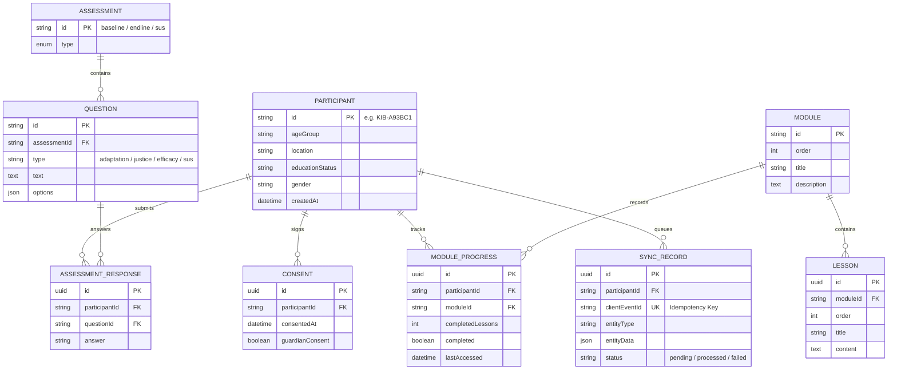
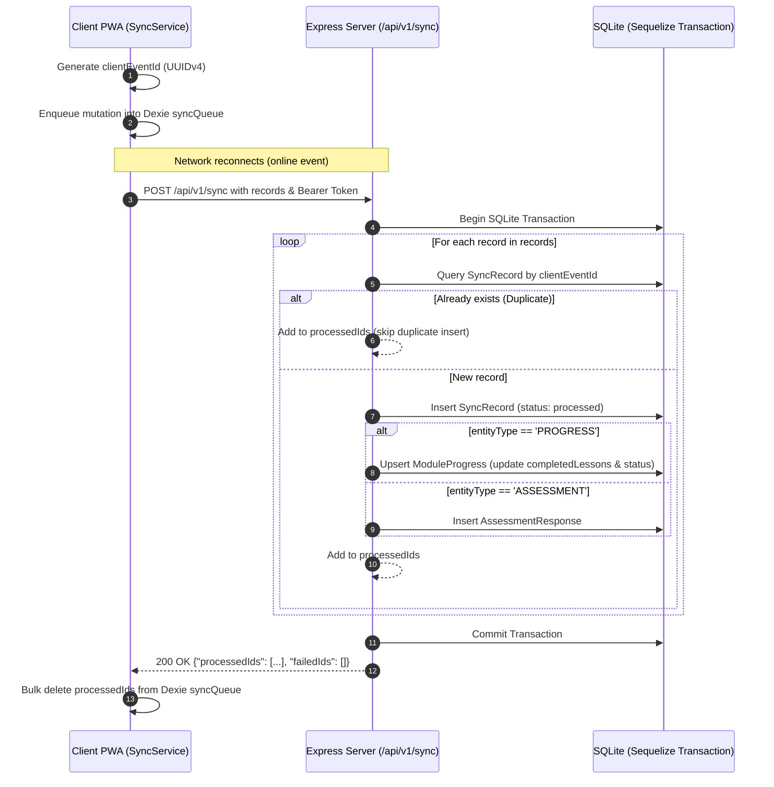
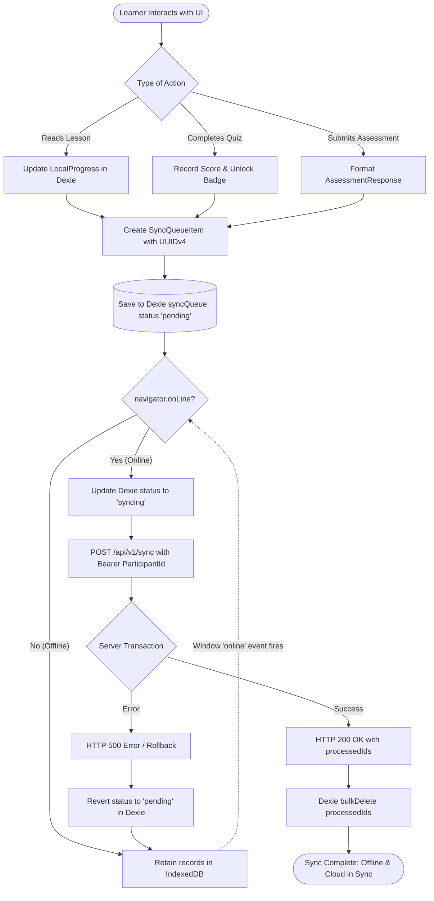

# Climate Justice Nairobi — Comprehensive Project Architecture, Technical Specification & Full Website Content

> **Project Title:** Designing and Evaluating a Mobile-First Progressive Web Application to Support Climate Adaptation Literacy and Climate Justice Awareness Among Youth in Kibera and Ruaraka, Nairobi  
> **Author / Lead Developer:** John Obure (BSc. in Software Engineering)  
> **Supervisor:** Junior Turatsinze  
> **Institution:** African Leadership University (ALU)  
> **Repository:** [https://github.com/obure1always/Nairobi-Climate-Justice](https://github.com/obure1always/Nairobi-Climate-Justice)  
> **Target Audience:** Youth aged 15–24 years in Nairobi’s informal and low-income urban settlements (specifically Kibera and Ruaraka).

---

## Table of Contents

1. [Executive Summary & Problem Statement](#1-executive-summary--problem-statement)
2. [High-Level System Architecture](#2-high-level-system-architecture)
3. [Frontend Architecture & Deep-Dive](#3-frontend-architecture--deep-dive)
   - [3.1 Technology Stack & Rationale](#31-technology-stack--rationale)
   - [3.2 Design Philosophy & Design System ("Organic Biophilic")](#32-design-philosophy--design-system-organic-biophilic)
   - [3.3 State Management & Offline-First Storage Engine (Dexie / IndexedDB)](#33-state-management--offline-first-storage-engine-dexie--indexeddb)
   - [3.4 Internationalization & Localization (English & Kiswahili)](#34-internationalization--localization-english--kiswahili)
   - [3.5 Service Worker & PWA Caching Strategy](#35-service-worker--pwa-caching-strategy)
   - [3.6 Navigation & Routing Hierarchy](#36-navigation--routing-hierarchy)
   - [3.7 Component-by-Component Walkthrough](#37-component-by-component-walkthrough)
4. [Backend Architecture & Deep-Dive](#4-backend-architecture--deep-dive)
   - [4.1 Technology Stack & Runtime](#41-technology-stack--runtime)
   - [4.2 Relational Database Schema & Sequelize ORM Models](#42-relational-database-schema--sequelize-orm-models)
   - [4.3 RESTful API Endpoint Specifications](#43-restful-api-endpoint-specifications)
   - [4.4 Data Synchronization Protocol & Idempotency](#44-data-synchronization-protocol--idempotency)
   - [4.5 Privacy, Participant Anonymization & Research Ethics](#45-privacy-participant-anonymization--research-ethics)
   - [4.6 Admin Export & Data Pipeline](#46-admin-export--data-pipeline)
5. [Complete & Exhaustive Website Content](#5-complete--exhaustive-website-content)
   - [5.1 Onboarding Flow Content](#51-onboarding-flow-content)
   - [5.2 Module 1: Nairobi Climate Risk (Hatari ya Hali ya Hewa Nairobi)](#52-module-1-nairobi-climate-risk)
   - [5.3 Module 2: Urban Flooding (Mafuriko Mjini)](#53-module-2-urban-flooding)
   - [5.4 Module 3: Heat & Health (Joto na Afya)](#54-module-3-heat--health)
   - [5.5 Module 4: Water Stress & Disease Prevention (Uhaba wa Maji na Kuzuia Magonjwa)](#55-module-4-water-stress--disease-prevention)
   - [5.6 Module 5: Climate Justice (Haki ya Hali ya Hewa)](#56-module-5-climate-justice)
   - [5.7 Module 6: Green Claims / Greenwashing (Madai ya Kijani)](#57-module-6-green-claims--greenwashing)
   - [5.8 Module 7: Safe Civic Participation (Ushiriki Salama wa Kiraia)](#58-module-7-safe-civic-participation)
   - [5.9 Baseline & Endline Research Assessments](#59-baseline--endline-research-assessments)
   - [5.10 Curated Resource Directory](#510-curated-resource-directory)
   - [5.11 Static Pages: About, Help & FAQ, Profile](#511-static-pages-about-help--faq-profile)
6. [Data Flow & Offline Synchronization Lifecycle](#6-data-flow--offline-synchronization-lifecycle)
7. [Testing, Deployment & Operational Runbook](#7-testing-deployment--operational-runbook)

---

## 1. Executive Summary & Problem Statement

### 1.1 Context & Problem
Urban informal settlements across Nairobi—including **Kibera** (one of the largest informal settlements in Sub-Saharan Africa) and **Ruaraka** (a dense mixed industrial-residential settlement)—face compounding environmental crises:
- **Urban Heat Island (UHI) Effect:** High building density, corrugated iron roofing, asphalt, and lack of vegetation elevate temperatures far beyond surrounding rural landscapes, converting indoor dwellings into heat traps.
- **Flash Flooding & Drainage Infrastructure Deficits:** Inadequate civil stormwater drainage, coupled with uncollected solid waste clogging rivers and culverts, causes severe localized inundations during intense rainfall seasons (such as the March–May "Long Rains").
- **Water Contamination & Disease Outbreaks:** Flooding regularly breaches informal sanitation systems, mixing blackwater and runoff into potable water supplies, triggering recurrent outbreaks of waterborne diseases such as cholera and typhoid.
- **Connectivity & Economic Constraints:** Youth living in these informal areas frequently face high cellular data costs, unstable network coverage, low-to-mid-tier Android mobile devices, and limited hardware storage.
- **Information Asymmetry & Greenwashing:** Commercial and corporate actors increasingly deploy vague environmental marketing ("green claims"), while youth are often excluded from municipal decision-making or unaware of lawful, peaceful mechanisms for civic participation under Kenya's devolved county governance structure.

### 1.2 The Solution
**Climate Justice Nairobi** is a mobile-first Progressive Web Application (PWA) accompanied by a lightweight Express/SQLite backend. It provides:
1. **Zero-Data Friction / Offline-First Capability:** Once loaded, curriculum modules, lessons, illustrations, and assessments are cached locally via IndexedDB (`Dexie.js`) and Service Workers (`Workbox`).
2. **Asynchronous Background Synchronization:** Learner progress, quiz attempts, and evaluation metrics are recorded in local transactional queues. When network connectivity resumes, changes automatically synchronize to the research database with zero user intervention and complete idempotency.
3. **Bilingual Accessibility:** Native, seamless switching between **English** and **Kiswahili** across every UI label, lesson paragraph, quiz choice, and assessment prompt.
4. **Evidence-Led, Non-Partisan Curriculum:** Rooted in peer-reviewed climate adaptation literature, local policies (e.g., *Nairobi Climate Action Plan 2020–2050*, *Kenya Climate Change Act 2016*), and civic guidelines, completely free from political partisanship or sensationalized disaster rhetoric.

---

## 2. High-Level System Architecture

The overall application follows an offline-first client-server architecture:

```mermaid
graph TD
    subgraph Client [Client PWA (React 19 + TypeScript)]
        UI[UI Components & Pages]
        RC[React Context: Progress & Language]
        IDB[(IndexedDB: Dexie.js)]
        SW[Service Worker: Workbox / VitePWA]
        Sync[SyncService Queue Manager]
    end

    subgraph Network [Network Boundary]
        NetStatus{navigator.onLine}
    end

    subgraph Server [Backend API (Express 5 + TypeScript)]
        Router[API Route Controllers]
        AuthMid[Auth & Token Middleware]
        Sequelize[Sequelize ORM & Transactions]
        SQLite[(SQLite Database)]
        Admin[Admin Export Pipeline]
    end

    UI --> RC
    RC --> IDB
    RC --> Sync
    SW -. Caches Assets .-> UI
    Sync --> NetStatus
    NetStatus -- "Online: Flush Queue" --> Router
    Router --> AuthMid
    AuthMid --> Sequelize
    Sequelize --> SQLite
    Admin --> Sequelize
```

---

## 3. Frontend Architecture & Deep-Dive

### 3.1 Technology Stack & Rationale
- **React 19 (`react`, `react-dom`):** Leverages modern functional components, hooks, concurrent rendering, and minimal bundle footprint.
- **TypeScript (`~6.0.2` / `5.9+`):** Strict type safety across all domain entities (modules, quiz attempts, progress states, sync events).
- **Vite (`^5.4`):** Lightning-fast hot module replacement (HMR) and optimized rollup production bundling.
- **Tailwind CSS (`^3.4.19`):** Utility-first styling supplemented with a bespoke design system token set.
- **Framer Motion (`^11.18.2`):** Micro-animations, spring-based view transitions, and accessible progress indicators without jank.
- **Lucide React (`^1.48.0`):** Lightweight, consistent SVG iconography for visual affordance.
- **Dexie.js (`^4.4.6`) & Dexie React Hooks:** A transactional IndexedDB wrapper providing relational querying and offline persistence in client storage.
- **Vite PWA Plugin (`vite-plugin-pwa`):** Workbox-powered service worker generating automated offline caching and Web App Manifest installation (`manifest.webmanifest`).
- **React Router DOM (`^7.18.4`):** Declarative client-side routing with route guards for participant onboarding.

### 3.2 Design Philosophy & Design System ("Organic Biophilic")
The visual identity deliberately rejects stereotyped "harsh tech" or "gloomy NGO disaster" palettes in favor of a warm, human, grounded **"Organic Biophilic"** design language:
- **Color Roles:**
  - `forest-green` (`#228B22`) & `primary` (`#00331e` / `#194a32`): Core brand action, natural growth, trust.
  - `earth-brown` (`#8B4513`): Secondary grounding elements, quiz trigger buttons, rooted stability.
  - `cream-bg` (`#F5F5DC`) & `canvas-bg` (`#f8f8f6`): Warm, paper-like background that mitigates screen glare under Nairobi sunlight.
  - `success-acacia` (`#24824e`): Affirmative completion states, sync indicators, correct quiz choices.
  - `accent-amber` (`#e09f25`): Warning prompts, achievement stars, progress highlights.
  - `error-crimson` (`#c93b2b` / `#ba1a1a`): Incorrect quiz selections, reset warnings.
- **Geometry & Ergonomics:**
  - 24px organic rounded corners (`rounded-organic`).
  - Soft biophilic shadows (`shadow-natural: 0 8px 32px rgba(0,0,0,0.08)`).
  - Minimum 44×44px touch targets on all buttons to accommodate one-handed mobile usage.
  - Generous typographic line heights (1.55–1.60) to ease mobile reading fatigue.

### 3.3 State Management & Offline-First Storage Engine (Dexie / IndexedDB)
Local storage is managed by `ClimateJusticeDB` extending `Dexie` (located in [`client/src/db.ts`](file:///Users/johnobure/Nairobi-Climate-Justice/client/src/db.ts)):

```typescript
// IndexedDB Object Stores (Version 2)
modules: 'id, order'
syncQueue: '++id, clientEventId, status'
progress: 'moduleId'
quizAttempts: '++id, moduleId'
achievements: 'id'
settings: 'id'
```

#### State Interfaces
1. **`LocalProgress`**: Tracks completed lesson indices per module:
   ```typescript
   export interface LocalProgress {
     moduleId: string;
     completedLessons: number[]; // e.g. [0, 1]
     completed: boolean;
     lastAccessed: string;
   }
   ```
2. **`SyncQueueItem`**: Represents an offline mutation awaiting network transmission:
   ```typescript
   export interface SyncQueueItem {
     id?: number;
     clientEventId: string; // crypto.randomUUID()
     entityType: 'PROGRESS' | 'ASSESSMENT' | 'ACHIEVEMENT' | 'QUIZ_ATTEMPT' | 'SETTINGS';
     entityData: any;
     status: 'pending' | 'syncing' | 'failed';
     createdAt: string;
   }
   ```
3. **`UserSettings`**:
   ```typescript
   export interface UserSettings {
     id: string; // 'current'
     language: 'en' | 'sw';
     onboardingComplete: boolean;
     reducedMotion: boolean;
   }
   ```

#### Context Providers
- **`ProgressProvider` ([`client/src/contexts/ProgressContext.tsx`](file:///Users/johnobure/Nairobi-Climate-Justice/client/src/contexts/ProgressContext.tsx)):** Hydrates local Dexie state on app mount. Exposes `updateLessonProgress`, `completeModule`, `updateSettings`, and `unlockAchievement`. Every state update immediately persists into IndexedDB and enqueues a mutation into `SyncService`.
- **`LanguageProvider` ([`client/src/LanguageContext.tsx`](file:///Users/johnobure/Nairobi-Climate-Justice/client/src/LanguageContext.tsx)):** Houses UI translation dictionaries for English and Kiswahili, supplying the `t(key)` helper.

### 3.4 Internationalization & Localization (English & Kiswahili)
Language selection is instantaneous and reactive:
- Key phrases and UI labels are loaded from the translation map in `LanguageContext.tsx`.
- Deep educational content (modules, lessons, quizzes, assessments, and resource descriptions) are stored as typed data structures with parallel `en` and `sw` records in `data/modules.ts`, `data/assessments.ts`, and `data/resources.ts`.
- Switching language updates the user settings in Dexie and toggles the interface language globally without requiring a page reload.

### 3.5 Service Worker & PWA Caching Strategy
Configured via `vite-plugin-pwa` in [`client/vite.config.ts`](file:///Users/johnobure/Nairobi-Climate-Justice/client/vite.config.ts):
- **Pre-caching:** Pre-caches all production JS bundles, CSS, HTML, SVG icons, and local educational JPEG photography under `/images/*.jpg`.
- **Runtime Google Fonts Caching:** Configured with `CacheFirst` strategy, storing font files in `google-fonts-cache` with a 365-day TTL.
- **Web App Manifest:** Standalone display mode with `#344e41` theme bar and dual 192×192 and 512×512 icon definitions, enabling native "Add to Home Screen" installation on Android and iOS.

### 3.6 Navigation & Routing Hierarchy
Routes are declared in [`client/src/App.tsx`](file:///Users/johnobure/Nairobi-Climate-Justice/client/src/App.tsx) and guarded by `ProtectedRoute`:
- `/onboarding`: First-time setup. If `settings.onboardingComplete` is false, all routes redirect here.
- `/`: Public landing & home dashboard.
- `/learn`: Overview of all 7 curriculum modules with progress indicators.
- `/module/:moduleId`: Detailed view for a specific module (Intro -> Lesson Content -> Quiz -> Results).
- `/assessment`: Endline research assessment evaluation.
- `/progress`: Comprehensive learner analytics, module progress bar, and badge showcase.
- `/resources`: Categorized external reference directory.
- `/profile`: Language configuration, privacy controls, and local database reset.
- `/about`: Study background and research mission.
- `/help`: Frequently asked questions and offline guidance.

### 3.7 Component-by-Component Walkthrough
1. **`Onboarding.tsx`**: Two-step interactive onboarding. Step 1 selects language (English or Kiswahili). Step 2 explains the three pillars: *Learn*, *Practice & Quiz*, and *Track Progress*. Completing onboarding sends an anonymous registration request to `/api/v1/auth/register`, saves the returned participant ID (e.g., `KIB-A89B12`) in `localStorage`, and updates Dexie.
2. **`Navigation.tsx`**: Dual-mode navigation bar:
   - **Desktop (md+):** Fixed left sidebar with branding, primary links (Home, Learn, Progress, Resources, Profile), and secondary links (About, Help).
   - **Mobile:** Sticky bottom navigation bar with 5 primary icons (`Home`, `BookOpen`, `Trophy`, `FolderOpen`, `User`) and label text, styled for quick thumb access.
3. **`Layout.tsx`**: Master shell rendering the navigation and responsive content area. Contains an event listener on `navigator.onLine` that renders a warning banner (`You're offline. Previously downloaded lessons remain available.`) whenever the device loses internet connection.
4. **`Home.tsx`**: The main landing page. Features a hero section with animated ambient background gradients, a quick "Start Learning" button that automatically jumps to the learner's earliest unfinished module, three "Why This Matters" cards (*Urban Flooding*, *Extreme Heat*, *Water Security*), and preview cards for the first 3 modules.
5. **`Learn.tsx`**: Complete module index. Displays all seven modules as cards with thumbnail photography, order badges, brief summaries, progress bars, and dynamic action buttons (*Start*, *Continue*, or *Review*). Concludes with a "Final Assessment" prompt.
6. **`LessonView.tsx`**: The core learning state machine:
   - State `intro`: Displays hero image, module title, overview, and list of learning objectives.
   - State `lesson`: Renders step-by-step reading cards with headings and paragraphs, next/previous buttons, and progress counters.
   - State `quiz_start`: Transition screen inviting the learner to take the module quiz.
   - State `quiz_active`: Mounts `QuizEngine`.
   - State `results`: Shows final score, congratulatory message, retry options, and dispatches achievement badges (`FIRST_STEP`, `FLOOD_READY`, etc.).
7. **`QuizEngine.tsx`**: Reusable interactive quiz component. Features progress steps, radio selection cards with custom tick icons, answer verification with instant green/red styling, detailed explanatory text, and advancement buttons.
8. **`AssessmentView.tsx`**: Research instrument view for baseline/endline data collection. Supports multiple-choice questions and 5-point Likert scale cards (*Strongly Disagree* to *Strongly Agree*), queueing answers to `SyncService`.
9. **`Progress.tsx`**: Displays total completed modules count, circular/linear progress bars, and an achievement showcase list.
10. **`Resources.tsx`**: Card grid grouping verified educational, emergency, and civic resources into three categories, complete with external link buttons and source attributions.
11. **`Profile.tsx`**: Learner profile displaying completed module count, language selection dropdown, privacy statement, and a progress reset button.
12. **`About.tsx` & `Help.tsx`**: Informational pages covering study goals, non-partisan stance, and offline usage FAQ.
13. **`Dashboard.tsx`**: Alternative mobile dashboard showcasing high-density Material-style cards, live network status badge with pulsing acacia dot, manual sync trigger button, and circular SVG progress ring.

---

## 4. Backend Architecture & Deep-Dive

### 4.1 Technology Stack & Runtime
- **Node.js (`v18+` / `v22+`) & Express.js 5 (`express: ^5.2.1`):** High-throughput, non-blocking asynchronous HTTP server.
- **TypeScript & `tsx` (`^4.23.15`):** Native execution of TypeScript server files without preliminary compilation overhead.
- **Sequelize ORM (`^6.37.8`):** Type-safe object-relational mapping supporting transactions, migrations, and model associations.
- **SQLite 3 (`sqlite3: ^6.0.1`):** Embedded, zero-configuration SQL database stored on disk at `server/database.sqlite`.
- **CORS (`cors: ^2.8.6`):** Cross-Origin Resource Sharing middleware enabling secure API requests from the frontend client.
- **Supertest & Jest:** Integration testing harness for validating HTTP endpoints, database writes, and transaction rollbacks.

### 4.2 Relational Database Schema & Sequelize ORM Models
Defined in [`server/src/models/index.ts`](file:///Users/johnobure/Nairobi-Climate-Justice/server/src/models/index.ts):



### 4.3 RESTful API Endpoint Specifications

| Method | Endpoint | Auth | Purpose | Payload / Parameters | Success Response |
|---|---|---|---|---|---|
| `GET` | `/` | None | Landing status & HTML admin export console | None | HTML web page |
| `GET` | `/api/v1/health` | None | Health check & uptime probe | None | `{"status": "ok"}` |
| `POST` | `/api/v1/auth/register` | None | Anonymously enrolls a participant | `{"ageGroup", "location", "educationStatus", "gender"}` | `{"participantId": "KIB-XXXXXX"}` |
| `GET` | `/api/v1/modules` | None | Lists seeded learning modules | None | Array of `Module` objects ordered by `order ASC` |
| `POST` | `/api/v1/sync` | Bearer Token | Batched offline synchronization | `{"records": [SyncQueueItem, ...]}` | `{"processedIds": [...], "failedIds": [...]}` |
| `GET` | `/api/v1/admin/export` | Bearer Token | Researcher dataset dump | None | `{"participants": [...], "progress": [...], "assessments": [...]}` |

### 4.4 Data Synchronization Protocol & Idempotency
To prevent duplicate records from intermittent network dropouts, the `/api/v1/sync` endpoint in [`server/src/index.ts`](file:///Users/johnobure/Nairobi-Climate-Justice/server/src/index.ts) implements an **idempotent transactional protocol**:



If an unhandled exception occurs during processing, the entire transaction is rolled back via `await transaction.rollback()`, returning a `500 Internal Server Error`, leaving the client queue intact for automatic retry upon next connectivity check.

### 4.5 Privacy, Participant Anonymization & Research Ethics
In compliance with international research ethics standards and the Kenyan Data Protection Act (2019):
- **No Personally Identifiable Information (PII):** The application does not collect real names, national ID numbers, phone numbers, email addresses, or precise GPS coordinates.
- **De-identified Coded Tokens:** Each participant is assigned a randomized alphanumeric ID with a location prefix (e.g. `KIB-` for Kibera) generated via `Math.random().toString(36).substring(2, 8).toUpperCase()`.
- **Local Storage Isolation:** The authentication token stored in `localStorage` contains only this de-identified identifier, which doubles as the `Bearer` token in the `Authorization` HTTP header.

### 4.6 Admin Export & Data Pipeline
The researcher can inspect or export the entire empirical dataset:
- Direct API endpoint: `GET /api/v1/admin/export` with authorization header `Authorization: Bearer ADMIN-TEST`.
- Returns an aggregated JSON payload containing:
  1. All anonymized demographic records (`participants`).
  2. All module progress tracks and completion milestones (`progress`).
  3. All baseline and endline assessment submissions (`assessments`).
- The root route `/` provides an embedded HTML interactive dashboard with a "Download Dataset" button for rapid field auditing by research assistants.

---

## 5. Complete & Exhaustive Website Content

Below is the verbatim content embedded across every view of the application in both English and Kiswahili.

### 5.1 Onboarding Flow Content

#### Step 1: Language Selection
- **English Prompt:** "Welcome. Choose your preferred language to start learning."
- **Kiswahili Prompt:** "Karibu. Chagua lugha unayopendelea kuanza kujifunza."
- **Options:** English (`🇬🇧`) | Kiswahili (`🇰🇪`)

#### Step 2: How Learning Works (Jinsi Kujifunza Kunavyofanya Kazi)
1. **Learn (Jifunze):**
   - *EN:* "Read about Nairobi's climate."
   - *SW:* "Soma kuhusu hali ya hewa ya Nairobi."
2. **Practice & Quiz (Jibu Maswali):**
   - *EN:* "Answer questions to test your understanding."
   - *SW:* "Jibu maswali ili kujaribu uelewa wako."
3. **Track Progress (Fuatilia Maendeleo):**
   - *EN:* "Earn achievements as you learn."
   - *SW:* "Pata mafanikio unapojifunza."
- **Action Button:** "Start Learning" (EN) / "Anza Kujifunza" (SW)

---

### 5.2 Module 1: Nairobi Climate Risk

- **ID:** `m1` | **Image:** `/images/nairobi_climate_risk_1790629624713.jpg`
- **English Title:** Nairobi Climate Risk
- **English Description:** Understand the unique climate challenges facing our city.
- **Kiswahili Title:** Hatari ya Hali ya Hewa Nairobi
- **Kiswahili Description:** Kuelewa changamoto za kipekee za hali ya hewa zinazokabili jiji letu.

#### Lesson Content:
- **Lesson 1 Heading (EN):** The Urban Heat Island Effect  
  **Lesson 1 Heading (SW):** Athari ya Kisiwa cha Joto Mjini  
  - *Paragraph 1 (EN):* Nairobi is experiencing a phenomenon known as the Urban Heat Island (UHI) effect. Concrete and asphalt absorb heat, making the city significantly warmer than surrounding rural areas.
  - *Paragraph 1 (SW):* Nairobi inakabiliwa na hali inayojulikana kama Athari ya Kisiwa cha Joto Mjini (UHI). Saruji na lami hufyonza joto, na kufanya jiji kuwa na joto zaidi kuliko maeneo ya vijijini yanayozunguka.
  - *Paragraph 2 (EN):* This affects marginalized communities most, as informal settlements often lack green spaces and use heat-absorbing materials like corrugated iron sheets.
  - *Paragraph 2 (SW):* Hii inaathiri zaidi jamii zilizotengwa, kwani makazi yasiyo rasmi mara nyingi hukosa maeneo ya kijani na kutumia vifaa vinavyofyonza joto kama mabati.
- **Lesson 2 Heading (EN):** Changing Weather Patterns  
  **Lesson 2 Heading (SW):** Kubadilika kwa Mifumo ya Hali ya Hewa  
  - *Paragraph 1 (EN):* We are seeing more erratic rainfall. The "long rains" (March-May) are becoming less predictable, while extreme rainfall events are increasing in intensity.
  - *Paragraph 1 (SW):* Tunaona mvua zisizotabirika. "Mvua ndefu" (Machi-Mei) hazitabiriki sana, wakati matukio ya mvua kubwa yanaongezeka.
  - *Paragraph 2 (EN):* These rapid changes strain our city's infrastructure and threaten food security in local markets.
  - *Paragraph 2 (SW):* Mabadiliko haya ya haraka yanatia mkazo miundombinu ya jiji letu na kutishia usalama wa chakula.

#### Module Quiz:
- **Question (EN):** What is the Urban Heat Island effect?
- **Question (SW):** Je, athari ya Kisiwa cha Joto Mjini ni nini?
- **Options (EN):**
  1. When an island gets too hot
  2. When urban areas are warmer than surrounding rural areas due to human activities and infrastructure *(Correct)*
  3. A new weather system in Nairobi
  4. When cities plant too many trees
- **Options (SW):**
  1. Wakati kisiwa kinakuwa na joto sana
  2. Wakati maeneo ya mijini yana joto zaidi kuliko maeneo ya vijijini kutokana na shughuli za binadamu *(Correct)*
  3. Mfumo mpya wa hali ya hewa Nairobi
  4. Wakati miji inapanda miti mingi
- **Correct Index:** 1
- **Explanation (EN):** The UHI effect happens because concrete and asphalt absorb and retain heat more than natural landscapes.
- **Explanation (SW):** Athari ya UHI hutokea kwa sababu saruji na lami hufyonza na kuhifadhi joto zaidi kuliko mandhari ya asili.

---

### 5.3 Module 2: Urban Flooding

- **ID:** `m2` | **Image:** `/images/urban_flooding_1790629636632.jpg`
- **English Title:** Urban Flooding
- **English Description:** Learn how to navigate and mitigate flooding risks in informal settlements.
- **Kiswahili Title:** Mafuriko Mjini
- **Kiswahili Description:** Jifunze jinsi ya kukabiliana na hatari za mafuriko.

#### Lesson Content:
- **Lesson 1 Heading (EN):** Why Does Nairobi Flood?  
  **Lesson 1 Heading (SW):** Kwa Nini Nairobi Inafurika?  
  - *Paragraph 1 (EN):* Rapid urbanization without adequate drainage infrastructure leads to severe urban flooding during heavy rains.
  - *Paragraph 1 (SW):* Ukuaji wa miji bila miundombinu ya kutosha ya mifereji husababisha mafuriko makubwa wakati wa mvua kubwa.
  - *Paragraph 2 (EN):* Blocked drainage systems, often clogged with solid waste, exacerbate the problem, causing water to back up into residential areas.
  - *Paragraph 2 (SW):* Mifumo iliyoziba ya maji, mara nyingi inatokana na taka ngumu, inazidisha tatizo na kusababisha maji kujaa katika maeneo ya makazi.
- **Lesson 2 Heading (EN):** Community Resilience  
  **Lesson 2 Heading (SW):** Uthabiti wa Jamii  
  - *Paragraph 1 (EN):* Communities can build resilience by organizing neighborhood clean-ups to clear drainage ditches before the rainy season.
  - *Paragraph 1 (SW):* Jamii zinaweza kujenga uthabiti kwa kupanga usafishaji wa mitaa ili kuzibua mifereji kabla ya msimu wa mvua.
  - *Paragraph 2 (EN):* Raising floor levels and creating safe community evacuation plans are critical steps for protecting lives and property.
  - *Paragraph 2 (SW):* Kuinua viwango vya sakafu na kuunda mipango salama ya uokoaji wa jamii ni hatua muhimu za kulinda maisha na mali.

#### Module Quiz:
- **Question (EN):** What is a major cause of exacerbated urban flooding in Nairobi?
- **Question (SW):** Ni nini chanzo kikuu cha kuongezeka kwa mafuriko mjini Nairobi?
- **Options (EN):**
  1. Too many green spaces
  2. Blocked drainage systems due to solid waste *(Correct)*
  3. High altitude
  4. Underground springs
- **Options (SW):**
  1. Maeneo mengi ya kijani kibichi
  2. Mifumo iliyoziba ya mifereji kutokana na taka ngumu *(Correct)*
  3. Muinuko mkubwa
  4. Chemchemi za chini ya ardhi
- **Correct Index:** 1
- **Explanation (EN):** Solid waste often blocks drainage channels, preventing water from flowing away during heavy rains.
- **Explanation (SW):** Taka ngumu mara nyingi huziba mikondo ya mifereji, na kuzuia maji kutiririka wakati wa mvua kubwa.

---

### 5.4 Module 3: Heat & Health

- **ID:** `m3` | **Image:** `/images/heat_and_health_1790629650810.jpg`
- **English Title:** Heat & Health
- **English Description:** Protecting your community from extreme heat.
- **Kiswahili Title:** Joto na Afya
- **Kiswahili Description:** Kulinda jamii yako kutokana na joto kali.

#### Lesson Content:
- **Lesson 1 Heading (EN):** Health Impacts of Extreme Heat  
  **Lesson 1 Heading (SW):** Athari za Afya za Joto Kali  
  - *Paragraph 1 (EN):* Prolonged exposure to extreme heat can cause heat exhaustion, dehydration, and heatstroke. Vulnerable populations like the elderly and young children are at the highest risk.
  - *Paragraph 1 (SW):* Kukaa kwenye joto kali kwa muda mrefu kunaweza kusababisha uchovu wa joto, upungufu wa maji mwilini, na kiharusi cha joto. Watu walio hatarini kama wazee na watoto wadogo wako kwenye hatari kubwa zaidi.
  - *Paragraph 2 (EN):* Metal-roofed homes in informal settlements can reach dangerous indoor temperatures.
  - *Paragraph 2 (SW):* Nyumba za mabati katika makazi yasiyo rasmi zinaweza kufikia viwango vya joto hatari ndani.
- **Lesson 2 Heading (EN):** Mitigation Strategies  
  **Lesson 2 Heading (SW):** Mbinu za Kupunguza Athari  
  - *Paragraph 1 (EN):* Painting roofs white can reflect sunlight and reduce indoor temperatures significantly.
  - *Paragraph 1 (SW):* Kupaka paa rangi nyeupe kunaweza kuakisi mwanga wa jua na kupunguza joto la ndani kwa kiasi kikubwa.
  - *Paragraph 2 (EN):* Ensuring adequate ventilation and organizing community cooling centers can save lives during heatwaves.
  - *Paragraph 2 (SW):* Kuhakikisha uingizaji hewa wa kutosha na kupanga vituo vya kupooza vya jamii kunaweza kuokoa maisha wakati wa mawimbi ya joto.

#### Module Quiz:
- **Question (EN):** What is a simple community strategy to reduce indoor heat?
- **Question (SW):** Ni mbinu gani rahisi ya kijamii inayoweza kupunguza joto la ndani?
- **Options (EN):**
  1. Painting metal roofs white to reflect sunlight *(Correct)*
  2. Closing all windows permanently
  3. Using dark colored curtains
  4. Removing the roof
- **Options (SW):**
  1. Kupaka paa za mabati rangi nyeupe kuakisi mwanga wa jua *(Correct)*
  2. Kufunga madirisha yote kabisa
  3. Kutumia mapazia ya rangi nyeusi
  4. Kuondoa paa
- **Correct Index:** 0
- **Explanation (EN):** White paint reflects sunlight (high albedo), significantly reducing the heat absorbed by the roof.
- **Explanation (SW):** Rangi nyeupe huakisi mwanga wa jua (albedo kubwa), ikipunguza kwa kiasi kikubwa joto linalofyonzwa na paa.

---

### 5.5 Module 4: Water Stress & Disease Prevention

- **ID:** `m4` | **Image:** `/images/water_stress_1790629662981.jpg`
- **English Title:** Water Stress & Disease Prevention
- **English Description:** Managing safe water access during climate shocks.
- **Kiswahili Title:** Uhaba wa Maji na Kuzuia Magonjwa
- **Kiswahili Description:** Kusimamia upatikanaji wa maji salama wakati wa majanga.

#### Lesson Content:
- **Lesson 1 Heading (EN):** The Climate-Water Connection  
  **Lesson 1 Heading (SW):** Uhusiano wa Hali ya Hewa na Maji  
  - *Paragraph 1 (EN):* Droughts reduce water availability, forcing communities to rely on unsafe water sources, which increases the risk of waterborne diseases like cholera.
  - *Paragraph 1 (SW):* Ukame hupunguza upatikanaji wa maji, na kulazimisha jamii kutegemea vyanzo vya maji visivyo salama, jambo ambalo huongeza hatari ya magonjwa yanayosambazwa na maji kama kipindupindu.
  - *Paragraph 2 (EN):* Conversely, flooding can contaminate clean water supplies with sewage.
  - *Paragraph 2 (SW):* Kwa upande mwingine, mafuriko yanaweza kuchafua vyanzo safi vya maji kwa maji taka.
- **Lesson 2 Heading (EN):** Safe Water Practices  
  **Lesson 2 Heading (SW):** Mbinu Salama za Maji  
  - *Paragraph 1 (EN):* Always boil or treat water with chlorine before drinking, especially during and after floods.
  - *Paragraph 1 (SW):* Daima chemsha au tibu maji kwa klorini kabla ya kunywa, haswa wakati na baada ya mafuriko.
  - *Paragraph 2 (EN):* Community-managed water kiosks help ensure equitable access to safe water during periods of stress.
  - *Paragraph 2 (SW):* Vioski vya maji vinavyosimamiwa na jamii husaidia kuhakikisha upatikanaji sawa wa maji salama wakati wa shida.

#### Module Quiz:
- **Question (EN):** Why do floods increase the risk of waterborne diseases?
- **Question (SW):** Kwa nini mafuriko yanaongeza hatari ya magonjwa yanayosambazwa na maji?
- **Options (EN):**
  1. The water is too cold
  2. Floods can mix sewage with clean drinking water supplies *(Correct)*
  3. People drink more water during floods
  4. Floods wash away soap
- **Options (SW):**
  1. Maji yanakuwa baridi sana
  2. Mafuriko yanaweza kuchanganya maji taka na vyanzo vya maji safi ya kunywa *(Correct)*
  3. Watu wanakunywa maji mengi zaidi wakati wa mafuriko
  4. Mafuriko yanaosha sabuni
- **Correct Index:** 1
- **Explanation (EN):** Floodwaters often overwhelm sanitation systems, carrying raw sewage into drinking water sources.
- **Explanation (SW):** Maji ya mafuriko mara nyingi hulemea mifumo ya usafi wa mazingira, yakibeba maji taka ghafi kwenye vyanzo vya maji ya kunywa.

---

### 5.6 Module 5: Climate Justice

- **ID:** `m5` | **Image:** `/images/climate_justice_1790629675274.jpg`
- **English Title:** Climate Justice
- **English Description:** Advocating for fair climate policies for all.
- **Kiswahili Title:** Haki ya Hali ya Hewa
- **Kiswahili Description:** Kutetea sera za haki za hali ya hewa kwa wote.

#### Lesson Content:
- **Lesson 1 Heading (EN):** What is Climate Justice?  
  **Lesson 1 Heading (SW):** Haki ya Hali ya Hewa ni nini?  
  - *Paragraph 1 (EN):* Climate justice acknowledges that climate change has differing social, economic, and public health impacts on underprivileged populations.
  - *Paragraph 1 (SW):* Haki ya hali ya hewa inatambua kuwa mabadiliko ya tabianchi yana athari tofauti za kijamii, kiuchumi, na afya ya umma kwa makundi yasiyojiweza.
  - *Paragraph 2 (EN):* Those who contribute the least to greenhouse gas emissions often suffer the most severe consequences.
  - *Paragraph 2 (SW):* Wale wanaochangia kiasi kidogo zaidi cha uzalishaji wa gesi chafu mara nyingi huteseka kutokana na matokeo mabaya zaidi.
- **Lesson 2 Heading (EN):** The Right to Participate  
  **Lesson 2 Heading (SW):** Haki ya Kushiriki  
  - *Paragraph 1 (EN):* Every community has a right to participate in urban planning and climate adaptation policies.
  - *Paragraph 1 (SW):* Kila jamii ina haki ya kushiriki katika mipango miji na sera za kukabiliana na mabadiliko ya hali ya hewa.
  - *Paragraph 2 (EN):* Equitable distribution of resources, such as green infrastructure, is a fundamental human right.
  - *Paragraph 2 (SW):* Usambazaji sawa wa rasilimali, kama vile miundombinu ya kijani, ni haki ya kimsingi ya binadamu.

#### Module Quiz:
- **Question (EN):** What is the core principle of Climate Justice?
- **Question (SW):** Ni kanuni gani kuu ya Haki ya Hali ya Hewa?
- **Options (EN):**
  1. Everyone should experience exactly the same weather
  2. Acknowledging and addressing the unequal impacts of climate change on vulnerable populations *(Correct)*
  3. Taking polluters to court only
  4. Ignoring social inequalities
- **Options (SW):**
  1. Kila mtu anapaswa kupata hali ya hewa sawa kabisa
  2. Kutambua na kushughulikia athari zisizo sawa za mabadiliko ya hali ya hewa kwa makundi yaliyo hatarini *(Correct)*
  3. Kuwapeleka wachafuzi mahakamani pekee
  4. Kupuuza ukosefu wa usawa wa kijamii
- **Correct Index:** 1
- **Explanation (EN):** Climate justice focuses on the social and human rights aspects of climate change, ensuring vulnerable groups are protected and heard.
- **Explanation (SW):** Haki ya hali ya hewa inaangazia mambo ya kijamii na haki za binadamu za mabadiliko ya tabianchi, kuhakikisha vikundi vilivyo hatarini vinalindwa na kusikilizwa.

---

### 5.7 Module 6: Green Claims / Greenwashing

- **ID:** `m6` | **Image:** `/images/green_claims_1790629686768.jpg`
- **English Title:** Green Claims
- **English Description:** Identifying greenwashing and false environmental promises.
- **Kiswahili Title:** Madai ya Kijani (Greenwashing)
- **Kiswahili Description:** Kutambua uongo wa kimazingira.

#### Lesson Content:
- **Lesson 1 Heading (EN):** Understanding Greenwashing  
  **Lesson 1 Heading (SW):** Kuelewa Uongo wa Kimazingira  
  - *Paragraph 1 (EN):* Greenwashing is when a company or organization spends more time and money claiming to be "green" through advertising than actually implementing business practices that minimize environmental impact.
  - *Paragraph 1 (SW):* Uongo wa kimazingira (Greenwashing) ni wakati kampuni au shirika linatumia muda na pesa nyingi kudai kuwa "linajali mazingira" kupitia matangazo badala ya kutekeleza mazoea ya biashara yanayopunguza athari za mazingira.
  - *Paragraph 2 (EN):* Look out for vague terms like "eco-friendly" or "all-natural" without clear, verifiable evidence.
  - *Paragraph 2 (SW):* Jihadhari na maneno yasiyoeleweka kama "rafiki kwa mazingira" au "asilimia 100 asilia" bila ushahidi wazi, unaoweza kuthibitishwa.
- **Lesson 2 Heading (EN):** Holding Actors Accountable  
  **Lesson 2 Heading (SW):** Kuwawajibisha Wadau  
  - *Paragraph 1 (EN):* Demand transparency. Real climate action involves verifiable data, transparent supply chains, and significant reduction in emissions, not just offsetting.
  - *Paragraph 1 (SW):* Dai uwazi. Hatua halisi za hali ya hewa zinahusisha data inayoweza kuthibitishwa, minyororo ya ugavi ya wazi, na kupunguza kwa kiasi kikubwa uzalishaji wa gesi chafu, si tu kulipia uchafuzi (offsetting).
  - *Paragraph 2 (EN):* Community awareness is the first defense against false green claims.
  - *Paragraph 2 (SW):* Uelewa wa jamii ni ulinzi wa kwanza dhidi ya madai ya uongo ya kimazingira.

#### Module Quiz:
- **Question (EN):** Which of the following is a sign of greenwashing?
- **Question (SW):** Ni kipi kati ya yafuatayo ni dalili ya greenwashing?
- **Options (EN):**
  1. Detailed public sustainability reports
  2. Vague claims like "100% natural" without any certification or proof *(Correct)*
  3. Companies reducing their carbon footprint
  4. Community-led environmental reviews
- **Options (SW):**
  1. Ripoti za kina za uendelevu za umma
  2. Madai yasiyoeleweka kama "asilimia 100 asilia" bila udhibitisho au uthibitisho wowote *(Correct)*
  3. Kampuni zinazopunguza alama yao ya kaboni
  4. Ukaguzi wa mazingira unaoongozwa na jamii
- **Correct Index:** 1
- **Explanation (EN):** Vague, unverified buzzwords are a classic sign of greenwashing meant to deceive consumers.
- **Explanation (SW):** Maneno yasiyothibitishwa ni dalili ya kawaida ya greenwashing inayokusudiwa kuwadanganya wateja.

---

### 5.8 Module 7: Safe Civic Participation

- **ID:** `m7` | **Image:** `/images/civic_participation_1790629699025.jpg`
- **English Title:** Safe Civic Participation
- **English Description:** Engaging in climate action effectively and safely.
- **Kiswahili Title:** Ushiriki Salama wa Kiraia
- **Kiswahili Description:** Kushiriki katika hatua za hali ya hewa kwa ufanisi.

#### Lesson Content:
- **Lesson 1 Heading (EN):** The Power of Community Action  
  **Lesson 1 Heading (SW):** Nguvu ya Vitendo vya Jamii  
  - *Paragraph 1 (EN):* Civic participation is vital for pushing local governments to prioritize climate resilience.
  - *Paragraph 1 (SW):* Ushiriki wa raia ni muhimu kwa kusukuma serikali za mitaa kutoa kipaumbele kwa uthabiti wa hali ya hewa.
  - *Paragraph 2 (EN):* Working through established community groups (CBOs) amplifies your voice and provides a safe structure for advocacy.
  - *Paragraph 2 (SW):* Kufanya kazi kupitia vikundi vya kijamii (CBOs) kunaimarisha sauti yako na kutoa muundo salama wa utetezi.
- **Lesson 2 Heading (EN):** Safe Engagement  
  **Lesson 2 Heading (SW):** Ushiriki Salama  
  - *Paragraph 1 (EN):* Understand your rights. Participate in legal public forums and budget hearings to demand climate action.
  - *Paragraph 1 (SW):* Elewa haki zako. Shiriki katika majukwaa halali ya umma na vikao vya bajeti kudai hatua za hali ya hewa.
  - *Paragraph 2 (EN):* Focus on constructive dialogues, coalition building, and evidence-based demands to ensure your community's needs are met peacefully and effectively.
  - *Paragraph 2 (SW):* Zingatia mazungumzo yenye kujenga, kujenga ushirikiano, na madai yanayotegemea ushahidi ili kuhakikisha mahitaji ya jamii yako yanatimizwa kwa amani na ufanisi.

#### Module Quiz:
- **Question (EN):** What is an effective way to safely participate in civic climate action?
- **Question (SW):** Ni ipi njia bora ya kushiriki kwa usalama katika hatua za kiraia za hali ya hewa?
- **Options (EN):**
  1. Acting completely alone without talking to neighbors
  2. Working through Community Based Organizations (CBOs) and attending local budget hearings *(Correct)*
  3. Only posting on social media
  4. Ignoring local government completely
- **Options (SW):**
  1. Kutenda peke yako kabisa bila kuzungumza na majirani
  2. Kufanya kazi kupitia Mashirika ya Kijamii (CBOs) na kuhudhuria vikao vya bajeti vya mitaa *(Correct)*
  3. Kuchapisha kwenye mitandao ya kijamii pekee
  4. Kupuuza serikali ya mtaa kabisa
- **Correct Index:** 1
- **Explanation (EN):** CBOs provide organized, safe, and effective platforms to collectively advocate for community needs at government forums.
- **Explanation (SW):** CBOs hutoa majukwaa yaliyopangwa, salama, na yenye ufanisi kwa kutetea kwa pamoja mahitaji ya jamii katika mikutano ya serikali.

---

### 5.9 Baseline & Endline Research Assessments

The application incorporates parallel **Baseline** (pre-intervention) and **Endline** (post-intervention) measurement instruments to evaluate shifts in climate adaptation literacy, climate justice awareness, and perceived self-efficacy.

#### Assessment Overview:
- **Baseline Description (EN):** "Please answer these questions honestly so we can understand your current knowledge before starting the modules."
- **Baseline Description (SW):** "Tafadhali jibu maswali haya kwa uaminifu ili tuweze kuelewa uelewa wako wa sasa kabla ya kuanza moduli."
- **Endline Description (EN):** "Thank you for completing the curriculum! Please answer these questions to help us measure your learning progress."
- **Endline Description (SW):** "Asante kwa kukamilisha mtaala huu! Tafadhali jibu maswali haya ili kutusaidia kupima maendeleo yako ya kujifunza."

#### Questions Breakdown:
1. **Question 1 (`b1` / `e1`):**
   - *Type:* Likert Scale (1 = Strongly Disagree / Sikubaliani Kabisa to 5 = Strongly Agree / Nakubaliana Kabisa)
   - *Text (EN):* "How would you rate your current understanding of Climate Justice?"
   - *Text (SW):* "Ungekadiaje uelewa wako wa sasa wa Haki ya Hali ya Hewa?"
2. **Question 2 (`b2` / `e2`):**
   - *Type:* Multiple Choice
   - *Text (EN):* "Which of the following best describes the Urban Heat Island effect?"
   - *Text (SW):* "Ni kipi kati ya vifuatavyo kinaelezea vyema athari ya Kisiwa cha Joto Mjini (Urban Heat Island)?"
   - *Options (EN):*
     1. Rural areas being hotter than cities
     2. Cities retaining more heat due to concrete and lack of vegetation *(Key)*
     3. A new type of solar panel
     4. I don't know
   - *Options (SW):*
     1. Maeneo ya vijijini kuwa na joto kuliko miji
     2. Miji kuhifadhi joto zaidi kutokana na saruji na ukosefu wa uoto wa asili *(Key)*
     3. Aina mpya ya paneli ya jua
     4. Sijui
3. **Question 3 (`b3` / `e3`):**
   - *Type:* Multiple Choice
   - *Text (EN):* "What is the most common cause of localized flooding in informal settlements?"
   - *Text (SW):* "Ni nini chanzo cha kawaida cha mafuriko ya ndani katika makazi yasiyo rasmi?"
   - *Options (EN):*
     1. Rising sea levels
     2. Blocked drainage channels due to solid waste *(Key)*
     3. Melting glaciers
     4. I don't know
   - *Options (SW):*
     1. Kupanda kwa viwango vya bahari
     2. Mifereji iliyoziba kutokana na taka ngumu *(Key)*
     3. Kuyeyuka kwa theluji
     4. Sijui
4. **Question 4 (`b4` / `e4`):**
   - *Type:* Likert Scale (1 = Strongly Disagree / Sikubaliani Kabisa to 5 = Strongly Agree / Nakubaliana Kabisa)
   - *Text (EN):* "I feel confident in my ability to participate in local government climate decisions."
   - *Text (SW):* "Ninajiamini katika uwezo wangu wa kushiriki katika maamuzi ya hali ya hewa ya serikali ya mitaa."

---

### 5.10 Curated Resource Directory

The Resources library categorizes official documents and operational guides into three functional domains:

#### Category 1: Learn More (Jifunze Zaidi)
1. **Kenya Climate Change Act 2016**
   - *Description:* Understanding Kenya's legal framework for responding to climate change.
   - *Source:* Kenya Law
   - *URL:* `https://new.kenyalaw.org/akn/ke/act/2016/11/eng%402022-12-31`
2. **Nairobi Climate Action Plan 2020–2050**
   - *Description:* Explore Nairobi City's climate mitigation and adaptation priorities.
   - *Source:* Nairobi City County Government
   - *URL:* `https://nairobi.go.ke/climate-action-plan-2020-2050`
3. **Nairobi Climate Action Plan 2020–2050 - Full Document**
   - *Description:* Access the full Nairobi Climate Action Plan for deeper research.
   - *Source:* KIPPRA Repository / County Government of Nairobi
   - *URL:* `https://repository.kippra.or.ke/items/8f93f334-1dcc-4bfc-8615-b357180fe067`

#### Category 2: Emergency & Preparedness (Maandalizi ya Dharura)
4. **Kenya Red Cross - Floods Operations**
   - *Description:* Learn about flood preparedness, response and safety information relevant to Kenya.
   - *Source:* Kenya Red Cross Society
   - *URL:* `https://redcross.or.ke/floods/`
5. **Kenya Red Cross Emergency Support**
   - *Description:* Find flood and emergency preparedness information and support from the Kenya Red Cross Society.
   - *Source:* Kenya Red Cross Society
   - *URL:* `https://redcross.or.ke/floods/`

#### Category 3: Rights & Civic Participation (Haki na Ushiriki)
6. **County Public Participation Guidelines**
   - *Description:* Learn how residents can participate in county policy, planning, budgeting, implementation, monitoring and evaluation.
   - *Source:* Government of Kenya
   - *URL:* `https://knowledgehub.devolution.go.ke/wp-content/uploads/2022/05/county-public-participation_january-2016.pdf`
7. **Kenya Policy on Public Participation - Sessional Paper No. 3 of 2023**
   - *Description:* Understand Kenya's national framework for public participation and citizen engagement.
   - *Source:* Kenya Law Reform Commission / Office of the Attorney-General and Department of Justice
   - *URL:* `https://www.klrc.go.ke/index.php/reports-and-publications/752-kenya-policy-on-public-participation-sessional-paper-no-3-of-2023`

---

### 5.11 Static Pages: About, Help & FAQ, Profile

#### About Page (`About.tsx`):
- **Heading:** About the Project (Kuhusu Mradi)
  - *EN:* "Climate Justice Nairobi is an educational platform aimed at building awareness about climate change and environmental justice in Nairobi's neighborhoods."
  - *SW:* "Climate Justice Nairobi ni jukwaa la elimu linalolenga kujenga uelewa kuhusu mabadiliko ya tabianchi na haki za kimazingira katika mitaa ya Nairobi."
- **Section 2:** Our Goal (Lengo Letu)
  - *EN:* "We provide accessible education regarding climate risks, such as urban flooding and extreme heat, and how communities can participate in mitigating these impacts."
  - *SW:* "Tunatoa elimu inayopatikana kwa urahisi kuhusu hatari za hali ya hewa, kama vile mafuriko na joto kali, na jinsi jamii zinaweza kushiriki katika kupunguza athari hizi."
- **Section 3:** Research and Education (Utafiti na Elimu)
  - *EN:* "This content is based on research and recommendations on how to improve civic participation in climate issues, maintaining a non-partisan and educational focus."
  - *SW:* "Maudhui haya yanategemea utafiti na mapendekezo ya jinsi ya kuboresha ushiriki wa kiraia katika masuala ya hali ya hewa, bila kuegemea upande wowote wa kisiasa."

#### Help & FAQ Page (`Help.tsx`):
1. **Can I use this platform offline? (Je, ninaweza kutumia jukwaa hili bila intaneti?)**
   - *Answer (EN):* "Yes! After your first visit, the lessons are cached on your device so you can continue learning offline."
   - *Answer (SW):* "Ndiyo! Baada ya kufungua mara ya kwanza, masomo yanahifadhiwa kwenye kifaa chako na unaweza kujifunza bila intaneti."
2. **Where is my progress saved? (Maendeleo yangu yanahifadhiwa wapi?)**
   - *Answer (EN):* "Your progress is securely saved locally on the device you are currently using."
   - *Answer (SW):* "Maendeleo yanahifadhiwa kwenye kifaa unachotumia (kama simu au kompyuta yako)."
3. **How do I change the language? (Ninawezaje kubadilisha lugha?)**
   - *Answer (EN):* "You can switch between English and Kiswahili at any time from the Profile page."
   - *Answer (SW):* "Unaweza kubadilisha lugha kati ya Kiingereza na Kiswahili kwenye ukurasa wa Profaili."

#### Profile & Settings Page (`Profile.tsx`):
- **User Avatar & Status:** Learner badge showing completed modules count (`X Modules Completed` / `X Masomo Yamekamilika`).
- **Language Switcher:** Interactive dropdown selecting between English and Kiswahili.
- **Privacy & Data (Faragha na Data):** Explains that learner progress is saved directly on their phone or computer.
- **Data Reset (Futa Maendeleo):** Destructive action confirming with a modal before wiping `localStorage` and IndexedDB cache for fresh testing runs.

---

## 6. Data Flow & Offline Synchronization Lifecycle



---

## 7. Testing, Deployment & Operational Runbook

### 7.1 Automated Testing Suites

#### Backend Integration Tests (Jest + Supertest):
Located in [`server/tests/api.test.ts`](file:///Users/johnobure/Nairobi-Climate-Justice/server/tests/api.test.ts):
- Verifies participant registration via `/api/v1/auth/register`.
- Validates batch processing of offline sync payloads at `/api/v1/sync`.
- Confirms researcher export data extraction at `/api/v1/admin/export`.
```bash
cd server
npm test
```

#### Frontend Unit & DOM Tests (Vitest + Testing Library):
Located in [`client/src/components/QuizEngine.test.tsx`](file:///Users/johnobure/Nairobi-Climate-Justice/client/src/components/QuizEngine.test.tsx):
- Validates quiz rendering, option selection state, validation logic, and score compilation in jsdom.
```bash
cd client
npm test
```

### 7.2 Local Development Commands
1. **Launch Server:**
   ```bash
   cd server
   npm install
   npm run dev    # Starts tsx watch on http://localhost:3001
   ```
2. **Launch Client:**
   ```bash
   cd client
   npm install
   npm run dev    # Starts Vite dev server on http://localhost:5173
   ```

### 7.3 End-to-End Backend Verification Script
A standalone test script [`test-backend.js`](file:///Users/johnobure/Nairobi-Climate-Justice/test-backend.js) is provided at the repository root to verify live endpoints:
```bash
node test-backend.js
```
The script automatically tests registration, synchronization of progress and assessment payloads, and admin dataset export.

### 7.4 Production Deployment Topology
- **Client (Frontend):**
  - Run `npm run build` inside `/client` to generate the static PWA bundle inside `/dist`.
  - Deploy `/dist` to a global edge CDN (Vercel, Cloudflare Pages, Netlify) with HTTPS enabled (mandatory for PWA Service Workers).
- **Server (Backend):**
  - Deploy `/server` to a Node.js cloud platform (Render, Railway, or AWS EC2).
  - Mount persistent volume storage for `database.sqlite` to ensure participant responses and sync records persist across container restarts.
  - Set environment variables: `PORT=3001` (or dynamic `$PORT`) and `NODE_ENV=production`.
